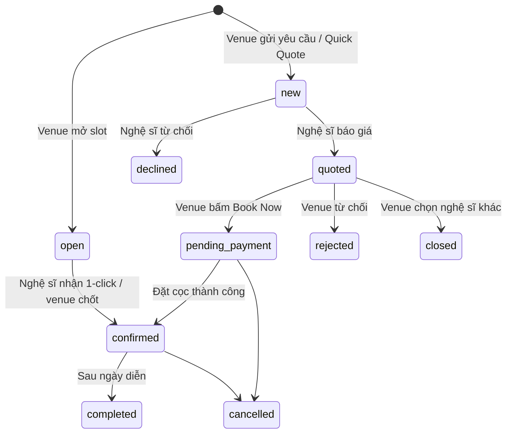

# Luồng người dùng & vòng đời booking

## Trạng thái booking
| Mã | Nghĩa |
|---|---|
| `open` | Slot nhà hàng mở, đang tìm nghệ sĩ |
| `new` | Yêu cầu báo giá mới, nghệ sĩ chưa trả lời |
| `quoted` | Nghệ sĩ đã gửi báo giá |
| `pending_payment` | Nhà hàng đã chọn báo giá, chờ đặt cọc |
| `confirmed` | Đã chốt (lộ thông tin liên hệ 2 bên) |
| `completed` | Đã diễn ra → mở đánh giá |
| `declined` | Nghệ sĩ từ chối |
| `rejected` | Nhà hàng từ chối báo giá |
| `cancelled` | Đã huỷ (áp chính sách huỷ cho tiền cọc) |
| `closed` | Nhà hàng đã chọn nghệ sĩ khác (cùng nhóm Quick Quote) |

Đang hoạt động: open, new, quoted, pending_payment, confirmed. Tính là "đã book": pending_payment, confirmed, completed.

## Luồng 1 – Slot công khai + bán vé
1. Nhà hàng → Lịch của tôi → **Mở slot** (ngày, giờ, thời lượng, loại nghệ sĩ, thù lao, thiết bị, bật bán vé: giá + sức chứa) → `open`.
2. Nghệ sĩ khớp thấy slot ở **Cơ hội đang chờ** → **Chấp nhận** → `confirmed`, show lên trang **Lịch diễn**, mở bán vé.
   (Hoặc nhà hàng vào **Tìm ca sĩ**, bấm ngày trống của một nghệ sĩ để chốt ngay.)
3. Khán giả → Lịch diễn → **Mua vé** → email + thanh toán → mã vé + QR.
4. Ngày diễn: nhà hàng nhập mã / quét QR để **check-in**.
5. Sau show → `completed` → nhà hàng đánh giá nghệ sĩ.

## Luồng 2 – Yêu cầu báo giá riêng
1. Nhà hàng mở hồ sơ nghệ sĩ → **Báo giá** → điền form → `new`.
2. Nghệ sĩ → Yêu cầu & báo giá → gửi báo giá → `quoted`.
3. Nhà hàng xem báo giá → **Book Now** → `pending_payment` → **đặt cọc** (% theo báo giá) → `confirmed`.
4. Diễn → `completed` → đánh giá.

## Luồng 3 – Quick Free Quote
1. Nhà hàng điền 1 form → hệ thống chọn ≤5 nghệ sĩ phù hợp → tạo ≤5 booking `new` cùng `groupId`.
2. Từng nghệ sĩ báo giá → `quoted`.
3. Nhà hàng xem **bảng so sánh báo giá** → chọn 1 → booking đó `pending_payment`, các booking còn lại `closed`.
4. Đặt cọc → `confirmed` → như luồng 2.

## Luồng 4 – Admin
Chọn khu vực → xem toàn bộ booking theo trạng thái → lọc "Cần hỗ trợ" → xem chi tiết 2 bên, lịch sử, tin nhắn → gửi ghi chú hỗ trợ / đánh dấu.

## Thông báo (ví dụ trong demo)
- Venue: có vé mới, slot đang tìm nghệ sĩ, nghệ sĩ gửi báo giá.
- Artist: yêu cầu mới, slot mới khớp, booking được chốt.
Mỗi booking có `history` (mốc thời gian + mô tả) và `messages` (chat).
